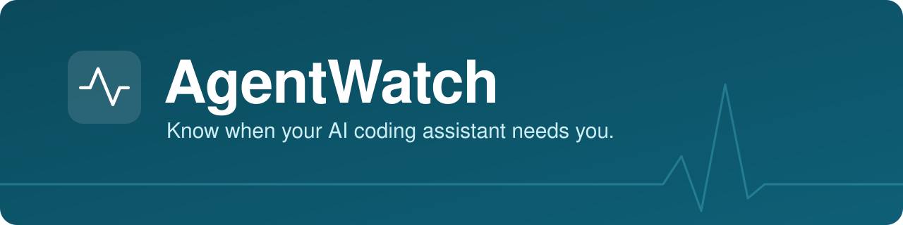
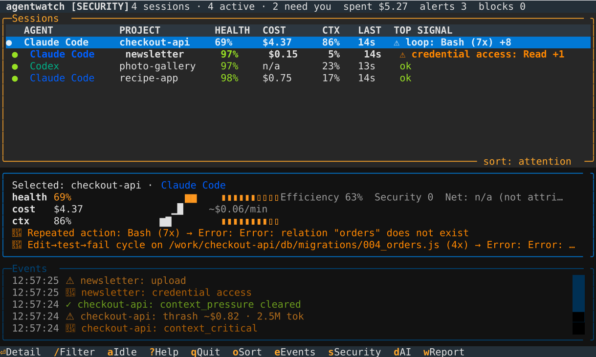

<p align="center">
  
</p>

<p align="center">
  <a href="https://pypi.org/project/agentwatch-monitor/"></a>
  <a href="https://www.python.org/downloads/"></a>
  <a href="https://github.com/LoomLabs-Venture-Studio/agentwatch/blob/main/LICENSE"></a>
  <br>
  <a href="https://agentwatch.info"><b>agentwatch.info</b></a>
</p>

AgentWatch watches Claude Code, Cursor, Codex and other AI coding assistants
while they work. It tells you when one is going in circles, keeps failing,
burns money, or does something risky with your keys or data. It runs on
your own computer and reads the logs your assistant already writes.



## Install

```bash
pipx install agentwatch-monitor
```

## Quick start

```bash
agentwatch check           # check your latest session
agentwatch watch-all       # live dashboard of every running assistant
agentwatch security-scan   # leaked keys, prompt injection, risky commands
agentwatch visual          # all the reports in your browser
agentwatch tools           # every tool a session used, and what failed
agentwatch subagents       # health of each subagent (cto, engineer, qa...)
```

Run `agentwatch --help` for all commands, or see
[agentwatch.info/commands](https://agentwatch.info/commands/).

## Works with

Claude Code · Cursor · Aider · Codex · GitHub Copilot (CLI and VS Code) ·
Antigravity · Gemini CLI · OpenCode · Kilo Code · Cline · Claude Desktop

Some are tested against sample logs only. See
[supported agents](https://agentwatch.info/supported-agents/).

## Claude Code plugin

Coaches Claude when it gets stuck, blocks a looping step, and asks you
before a catastrophic command or a read of your secrets files
(`agentwatch guard off` turns that off):

```text
/plugin marketplace add LoomLabs-Venture-Studio/agentwatch
/plugin install agentwatch@agentwatch
```

## What the scores mean

Every session gets a **health score** from 0 to 100:

| Score | | Meaning |
| --- | --- | --- |
| 80-100 | productive | Working normally |
| 60-79 | struggling | Something is slowing it down |
| 40-59 | spinning | Wasting effort, time to step in |
| 0-39 | stuck | Not getting anywhere |

The score blends three things:

- **Health checks**: going in circles, failing over and over, no progress,
  editing the same file over and over.
- **Context**: as the conversation fills up, assistants forget earlier work
  and re-read files they already saw. AgentWatch tracks this "context rot"
  over time.
- **Efficiency**: estimated cost, and how much went on steps that led
  nowhere.

With `--security`, you also get a verdict (secure, at risk or compromised)
from checks for leaked keys, prompt injection, dangerous commands and data
sent somewhere unexpected. All checks are plain rules, not AI: free to run
and the same answer every time.

## Privacy

No server, no account, no telemetry. Your code and conversations stay on
your computer.

## Contributing

Pull requests target `develop`. Setup: `pip install -e ".[dev,siem,llm]"`,
then `python -m pytest tests/` and `ruff check .`

MIT licensed. Built by [LoomLabs](https://loomlabs.io).
